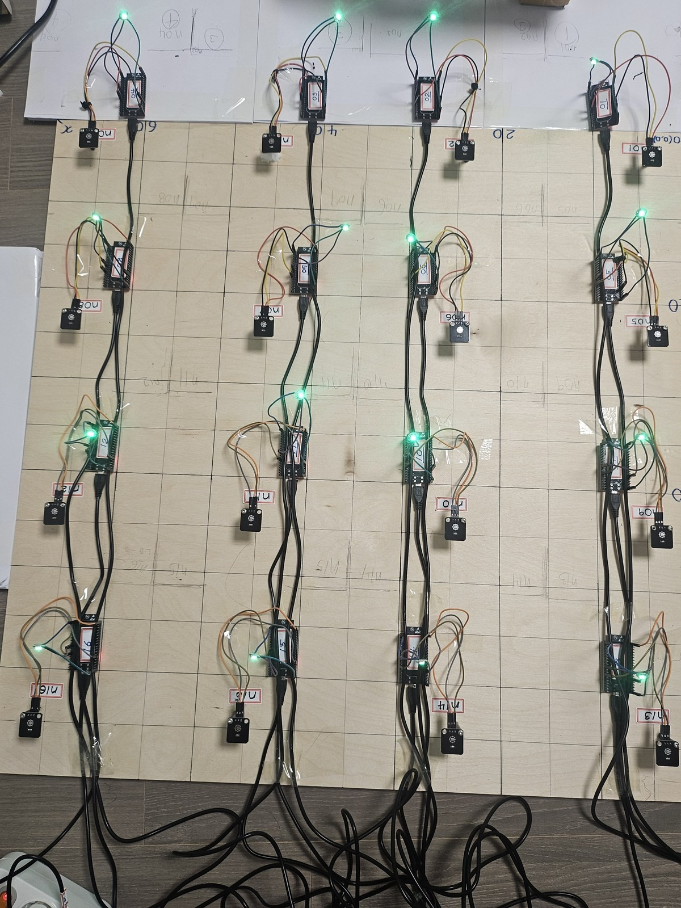
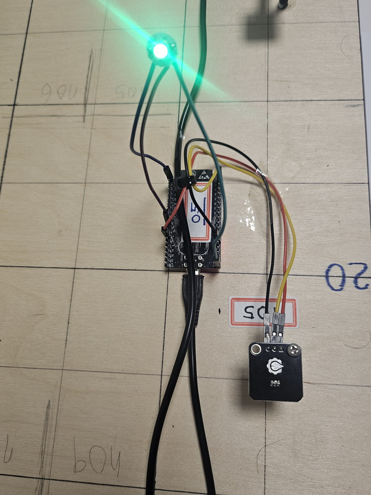
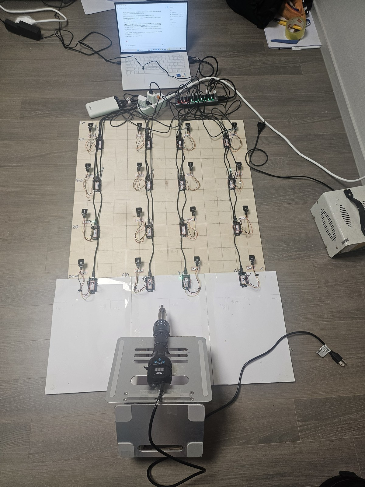
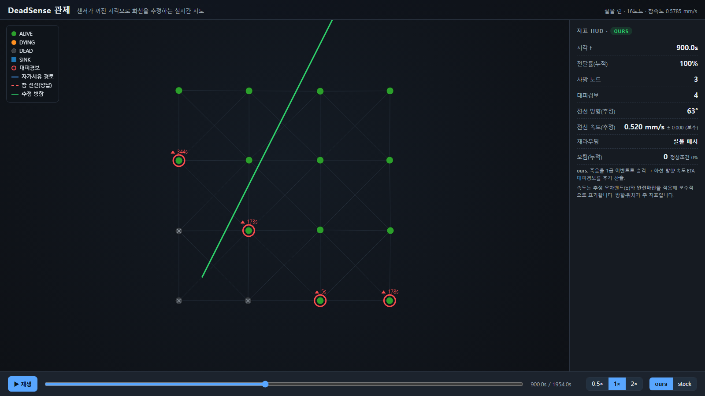
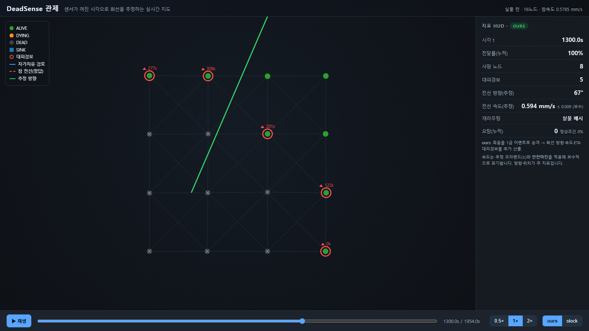
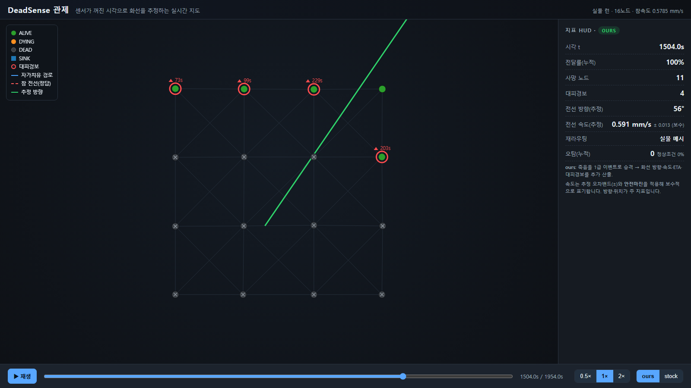
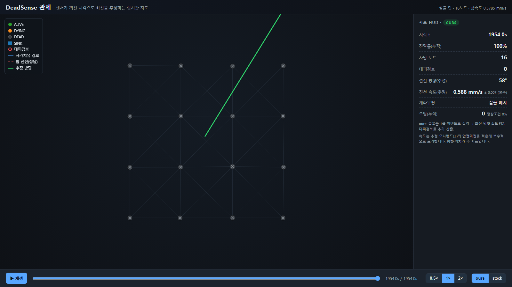

# DeadSense — 센서가 타서 꺼진 시각으로 산불의 방향과 속도를 추정한다

산불 감시 센서망은 센서가 살아서 온도를 보내는 걸 전제로 한다. 그런데 불 최전선에 있는 센서는 결국 탄다.
지금까지는 이렇게 꺼진 센서를 고장으로 보고 버렸다.

이 프로젝트는 거꾸로 본다. **센서가 꺼진 시각 = 불이 그 자리에 도착한 시각**이다.
꺼진 센서들의 위치와 시각을 모아 평면을 맞추면, 그 기울기에서 불이 번지는 방향과 속도가 나온다.
센서는 불을 견딜 필요가 없다. 타서 꺼지는 것 자체가 관측이 된다.

| | |
|---|---|
| **실물 실험** | ESP32 센서 16개 · 4×4 격자(간격 0.20 m) · 400℃ 열풍기를 정해 둔 경로로 옮김 · 80℃를 넘으면 꺼진 것으로 기록 (2026-09-01) |
| **결과** | 불의 방향 오차 **2.85°** · 속도 오차 **+1.67 %** · 꺼진 센서 **16/16** 검출, 오판 0 · 대피 경보 **13/16** 센서가 꺼지기 전에 받음 |
| **모의실험** | 바람·돌풍·통신 끊김·시계 오차 등 악조건 11가지 × 조건마다 30회 반복 |
| **재현** | 이 저장소 파일만으로 위 수치를 다시 계산할 수 있다 → [재현 ②](#재현--실물-실험-수치를-직접-다시-계산) |

<p>



</p>

---

## 실행 화면 — 실물 실험 기록을 대시보드로 다시 재생

`results/hw/run_205330.json`(실물 실험 1회의 전체 기록)을 대시보드에 넣고 주요 시각을 캡처했다.
초록 선이 추정한 불의 방향이고, 빨간 원은 대피 경보를 받은 센서다.

| 시각 | 화면 | 무슨 일이 있었나 |
|---|---|---|
| 900 s |  | 센서 3개가 꺼져서 첫 추정이 나왔다 |
| 1300 s |  | 꺼진 센서가 늘면서 추정이 흔들리고, 앞쪽 센서에 대피 경보가 간다 |
| 1504 s |  | 추정에 쓴 10번째 꺼짐부터 오차가 ±5° 안으로 들어왔다 (0.12°). 화면의 사망 11에는 판정에서 빠진 1개가 들어 있다 |
| 1954 s |  | 16개 모두 꺼짐. 최종 58.33° (참값 55.48°, 오차 2.85°), 0.588 mm/s |

직접 열어 보려면:

```bash
python tools/make_hw_dashboard.py      # dashboard/hw.html 생성
# dashboard/hw.html 을 브라우저로 연다 (서버 필요 없음). hw.html?f=1504 처럼 시각 지정 가능
```

---

## 어디를 보면 되나 — 핵심 파일 4개

| 파일 | 무엇을 하나 |
|---|---|
| [`sim/estimator.py`](sim/estimator.py) | **핵심 알고리즘.** 꺼진 센서들의 (x, y, t) → 이웃끼리 국소 평면 `t ≈ ax + by + c` → 기울기 ∇T 에서 방향·속도 |
| [`sim/verification.py`](sim/verification.py) | **오판 막기.** 통신만 잠깐 끊긴 센서와 진짜 타서 꺼진 센서를 3갈래로 가른다 |
| [`firmware/node/node.ino`](firmware/node/node.ino) | **센서 펌웨어.** 온도 감시 → 80℃ 넘으면 자기 시계로 꺼진 시각을 기록 → 마지막 신호 송신 |
| [`gateway/fw_adapter.py`](gateway/fw_adapter.py) | **센서 신호 → 추정기 입력 변환.** ESP32 시계가 71.6분마다 0으로 돌아가는 문제 보정 |

설계에서 제일 중요한 한 줄:
**꺼진 시각은 센서가 자기 시계로 찍은 값이다. 분석 컴퓨터가 받은 시각이 아니다.**
무선 지연이 시각에 섞이면 그대로 방향 오차가 되기 때문이다.

---

## 재현 ① — 하드웨어 없이 돌려 보기

```bash
pip install -r gateway/requirements.txt

# 1) 자동 테스트 60개
python -m pytest tests/ -q

# 2) 모의 스트림 → 분석 → 대시보드 데이터
python gateway/mock_serial.py
python gateway/gateway.py --in results/dashboard/mock_stream.jsonl --emit-dashboard

# 3) 펌웨어 신호 형식까지 포함한 전체 경로 (보드 없이)
python gateway/mock_fw_serial.py --fake 1
python gateway/gateway.py --in results/dashboard/mock_fw_stream.jsonl --fw --emit-dashboard
```

`mock_fw_serial.py` 가 만든 스트림은 모든 줄에 `fake=1` 이 들어간다. 합성 데이터가 실측으로 섞이지 않게 하려고 넣었다.

## 재현 ② — 실물 실험 수치를 직접 다시 계산

```bash
python tools/recompute_run205330.py
```

```
방향  참값 55.4826 °   추정 58.3293 °   오차 +2.8467 °  ->  2.85 °
속도  참값 0.0005785   추정 0.000588187   오차 +1.6745 %  ->  +1.67 %
사망  16 / 16 노드
경보  13 / 16 노드가 사망 전 수신
      리드타임  최소 87 · 중앙 344 · 최대 523 · 평균 351 초
```

읽는 파일은 두 개다. `results/hw/run_205330.json`(프레임 1,955개의 추정 기록)과
`results/hw/run_205330_deaths.csv`(센서별 좌표와 자기 시계로 찍은 꺼진 시각).
`results/hw/run_205330_raw.log` 는 실험 처음부터 끝까지의 원시 로그다.

「참값」은 열풍기를 옮긴 방향(점화점 → 판 중심)이다. 원형으로 퍼지는 불은 위치마다 방향이 달라서
대표 각도를 정하는 방법이 여럿 있는데, 그 경위는 [`docs/방향참값_출처_20260830.md`](docs/방향참값_출처_20260830.md)에 있다.
모든 수치의 기준은 [`docs/실측값_대장.md`](docs/실측값_대장.md) 하나다. 실패한 회차와 틀린 가설도 지우지 않고 남겼다.

### 방향 오차 2.85°는 어디서 왔나

같은 추정 코드에 꺼진 시각만 바꿔 넣어 원인을 나눠 본다. 새 측정이 아니라 재계산이다.

```bash
python tools/decompose_dir_error.py
```

```
참값 55.4826°
실제 측정 시각             방향  58.3293°  오차 +2.847°
둥근 화선 + 시각 오차 0      방향  58.3853°  오차 +2.903°
직선 화선 + 시각 오차 0      방향  55.4826°  오차 +0.000°
둥근 화선 + 시각 오차 σ=1.24 s: 평균 +2.902°, 90% 범위 +2.793 ~ +3.009°
둥근 화선 + 시각 오차 σ=10.4 s: 평균 +2.888°, 90% 범위 +1.978 ~ +3.785°
```

시각 오차가 없어도 둥근 화선만으로 2.90°가 나온다. 시계 오차보다 화선 모양의 비중이 크다.

## 모의실험 결과

[`results/stress/STRESS_REPORT.md`](results/stress/STRESS_REPORT.md) — 어디까지 버티고 어디서 깨지는지.
기본 조건 방향 오차 2.12°, 센서 개수별 실험(9~25개)으로 16개를 정한 근거([`results/density_sweep.csv`](results/density_sweep.csv)),
악조건별 원자료(`results/stress/raw_*.csv`)가 있다.

---

## 빌드 — ESP32 센서

| 항목 | 값 |
|---|---|
| 보드 | ESP32 DevKit WROOM-32 (FQBN `esp32:esp32:esp32`) |
| 코어 | `esp32:esp32@3.3.11` |
| 온도센서 | DS18B20 (1-Wire) |
| 표시 | WS2812 LED |

```bash
arduino-cli core install esp32:esp32@3.3.11
arduino-cli lib install "OneWire" "DallasTemperature" "Adafruit NeoPixel"
arduino-cli lib install "Painless Mesh"      # 공백 포함
arduino-cli lib install "Async TCP"          # 공백 포함
arduino-cli lib install "ArduinoJson@6.21.5" # 7.x 는 StaticJsonDocument 가 없다

cp firmware/node/secrets.h.example firmware/node/secrets.h   # 무선망 이름·비밀번호 채우기
powershell -File scripts/build_node.ps1 -Upload
```

한글 경로에서는 툴체인이 깨지니 영문 경로로 복사해서 빌드한다. 설치할 때 걸리는 것들은 [`firmware/BUILD.md`](firmware/BUILD.md).

분석 컴퓨터(라즈베리파이)에서 실보드 연결:

```bash
python gateway/gateway.py --port auto --fw --emit-dashboard
```

---

## 폴더

```
sim/         시뮬레이터 · 추정기 · 판정        ← 알고리즘 본체
firmware/    ESP32 센서 펌웨어 · 굽기 도구
gateway/     시리얼 수신 → 변환 → 추정기 → 대시보드
dashboard/   브라우저에서 바로 여는 관제 화면 (index.html = 모의, hw.html = 실물 기록)
tests/       자동 테스트 60개
scripts/     실험 도구 (모의실험·센서 개수 실험·현장 진행)
tools/       검산 도구 (실물 실험 수치 재계산 포함)
results/     hw/ = 실물 실험 기록 · stress/ = 모의실험 결과
docs/        수치 대장 · 실행 화면 · 사진
```

## 라이선스

Copyright (C) 2026 이동욱 · 숭실대학교 전자정보공학부

**GPL-3.0-only** ([`LICENSE`](LICENSE)). painlessMesh(GPL-3.0-only)를 링크하기 때문이다.
사용한 오픈소스와 라이선스 전문은 [`THIRD_PARTY.md`](THIRD_PARTY.md), [`licenses/`](licenses/).
